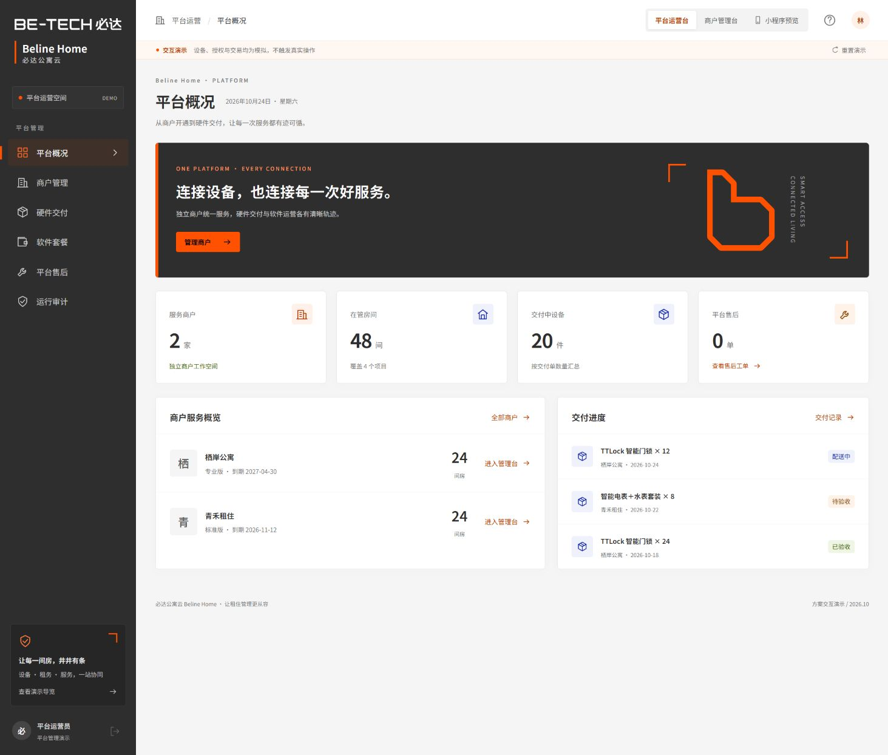
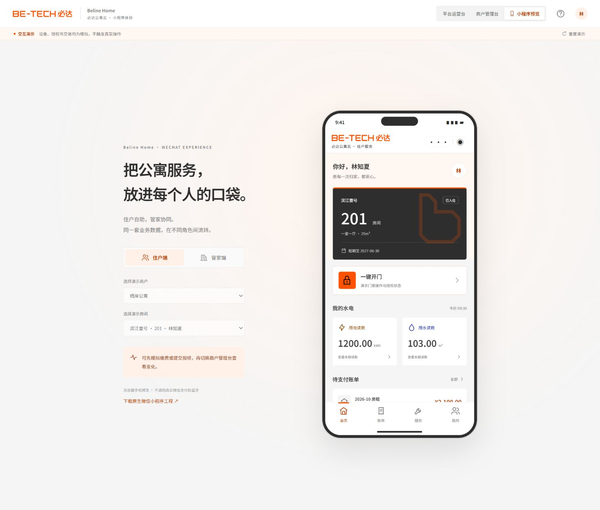
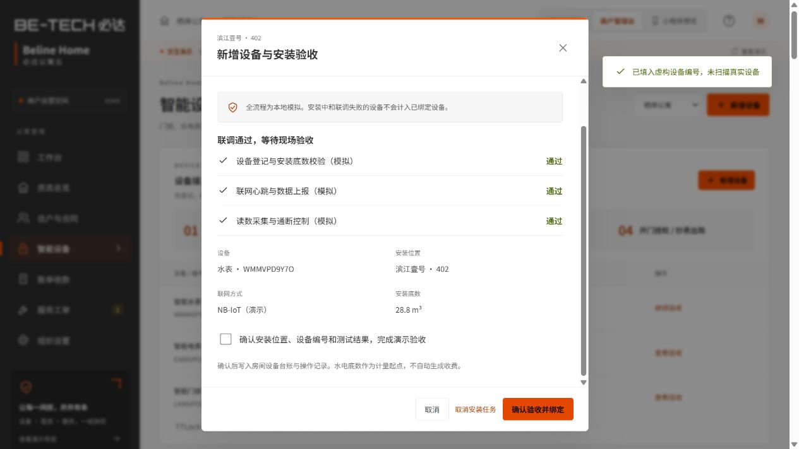

# 必达公寓云 · 智能公寓平台 Demo

用于确认产品结构、视觉和业务流程。产品名称：Beline Home｜必达公寓云。

## 打开

- 通用本机预览：安装 Node.js 后，在当前目录执行 `npm run dev`，打开 `http://127.0.0.1:5180/`。没有第三方 npm 安装步骤。
- 本机：双击 `启动演示.cmd`，浏览器访问 `http://127.0.0.1:5180/`。无需启动 MySQL、Redis 或 WSL。
- 在线：[GitHub Pages 公开演示](https://wintoking.github.io/beline-home-demo/)。
- 微信：在微信开发者工具导入 `wechat/`，参见其 README。需由用户登录开发者工具；游客模式不可用时请选择自己的测试 AppID。

## 覆盖范围

| 工作区 | 演示内容 |
|---|---|
| 平台运营 Web | 商户开通、进入商户、软件额度与有效期、硬件交付状态、转平台售后、运行审计导出 |
| 商户管理 Web | 运营看板、房态卡片与列表、项目与搜索筛选、添加房间、入住、续租、换房、临时授权、退租差额、设备控制、抄表出账、缴费与流水、报修派单、组织设置 |
| 小程序浏览器预览 | 住户首页、开门、水电读数、账单支付、报修进度、合同摘要；管家房态、设备、抄表和工单 |
| 原生微信小程序 | 住户和管家工作区、商户/房间切换、入住/续租/换房/临时授权/退租、模拟设备操作、账单支付、报修提交及处理 |

## 推荐确认路径

0. 商户管理台 → 智能设备 → 新增设备，选择房间和门锁/电表/水表。模拟扫描编号，完成安装配置、联调和验收。新样本每个项目的 402 室留空用于安装；已有存档可点击“先添加房间”。管家小程序也有“新增设备”入口。
1. 商户工作台点击“办理入住”，填虚构姓名和手机号，确认租期、费用及模拟授权。
2. 切换“小程序预览”，新入住的房间自动选中。缴费后切回商户管理台，看实收和流水变化。
3. 住户提交报修，商户受理派单并标记处理完成，住户确认归档。硬件问题可转平台售后。
4. 打开房间详情，体验续租、换房和临时授权；选择设备离线的 302 房间体验退租，检查“撤权待同步”。
5. 切换“平台运营台”，创建交付单，依次推进发货、安装、验收；开通商户后进入商户添加房间。
6. 切换第二家商户，检查项目、房间、账单和员工的展示范围。使用“重置演示”重新开始。

设备流程支持联调失败重试、稍后继续、取消未完成任务、验收记录和编号去重。验收前不绑定房间，验收门锁不自动给住户发放钥匙。表计按设备分别判定是否安装及在线；安装底数不直接产生费用，水电读数齐全后按演示费率和账期出账。交付单与逐台安装记录分别推进。

## 模拟边界

- 两家商户、四个项目、48 间房为虚构样本。日期固定为 2026-10-24，历史曲线标为演示样本。
- 浏览器使用 localStorage；同一页面中的所有工作区共享状态。原生小程序使用 wx 本地存储，与浏览器各自独立，不跨设备同步。
- 网页新版使用 `beline-home-demo-v2` 存储键，首次打开自动读取旧存档，不要求清空演示数据。
- 没有真实云后端、登录认证、商户权限安全隔离、支付回调、电子合同、TTLock、蓝牙或消息发送。界面商户切换仅用于演示。
- 离线指令进入待同步；不伪装硬件端已成功。退租仅展示现有账单与押金记录差额，不退款，实际运营还需末次抄表、验房和资金核对。
- 换房保留原房账单，不自动生成差价。本地样本未实现完整历史租约和资金账本，不能用于实际租务。
- 本次不新增系统软件、不更改 Windows 安全设置。原生工程仍需开发者工具运行及真机验证。

## 代码与验证

`dist/` 为可直接部署的网页；`dist/vendor/` 中 Vue 使用 MIT 许可，许可文本随附。所有数据与业务模型位于 `dist/model.js`，原生工程复用该文件。没有新增 npm 依赖。

使用现有 Node 执行 `node test-model.cjs` 和 `node validate.cjs`。详细验证与已知限制见 `VALIDATION.md`。

## 品牌更新与分享

已按必达 VI 手册统一平台、商户与小程序界面，参见 [VI 落地说明](VI-NOTES.md)。

GitHub 仓库启用 Pages 的 GitHub Actions 来源后，推送 `main` 会检查代码并自动部署 `dist/`。分享 Pages 链接即可让他人直接体验，不需要开发环境。浏览器端只保存各自的演示操作，未对接任何真实硬件或资金。

