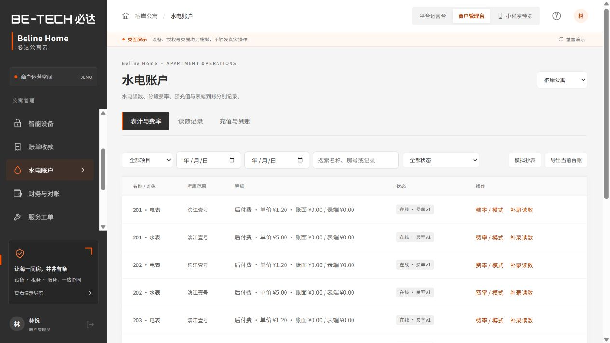
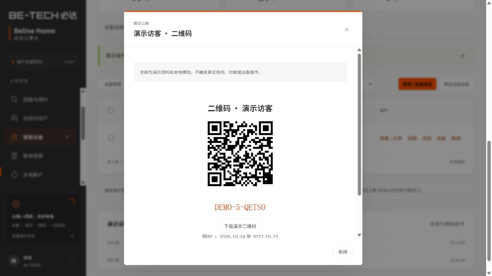
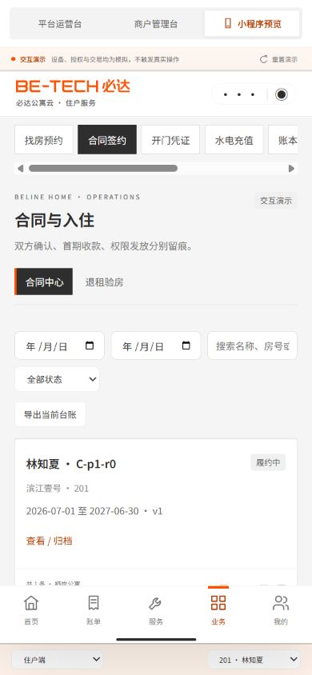

# Beline Home｜必达公寓云

面向独立房东、公寓运营商的硬件＋多商户 SaaS 产品交互 Demo，包含平台运营 Web、商户管理 Web、三角色手机预览及原生微信小程序工程。

- [直接打开公开演示](https://wintoking.github.io/beline-home-demo/)
- [功能与体验路径](FEATURES.md)
- [验证记录及限制](VALIDATION.md)
- [原生微信工程使用方法](wechat/README.md)
- [VI 落地说明](VI-NOTES.md)

## 本地运行

安装 Node.js 后，在此目录执行 `npm run dev`，访问 `http://127.0.0.1:5180/`。无需 npm 安装、MySQL、Redis 或 WSL。本机也可双击“启动演示.cmd”。微信开发者工具导入 `wechat/`，需登录及可用测试 AppID。

## 本次新增

招租预约、合同双方确认/签名/PDF/版本、设备能力/网关/凭证、独立水电账户与充值到账、退款对账、完整服务工单及退租验房、合作服务商结算、消息与经营报表。具体操作见功能指南。首期收款与设备授权、充值付款与表端入账、财务结清与撤权确认均分别留痕。

## 模拟边界

数据为两商户、四项目、48 间房的虚构样本，演示业务日期固定为 2026-10-24。浏览器使用 `beline-home-demo-v2` 并兼容旧存档；微信使用 wx 本地存储，两端不跨设备同步。

这是可评审的交互演示，未提供真实云后端、认证、服务端安全隔离、微信登录/支付、合法电子签存证、TTLock/蓝牙或消息发送。型号能力和联网方式是演示配置，正式接入需逐型号与样机验证。只使用虚构资料。默认欠费策略为提醒及人工复核。

## 代码与检查

`dist/` 可直接静态部署；`wechat/` 为原生工程。两端复用 `model.js` 与 `business.js`。Vue、二维码及 PDF 库随附许可，来源见 `dist/vendor/SOURCES.md`；没有 npm 依赖安装步骤。

执行 `npm test` 运行业务、原生控制器、PDF/二维码和静态检查。推送公开仓库 main 后，GitHub Actions 检查并部署 Pages。公开源代码不含外部参考 PDF、商业报价或任何接口密钥。

